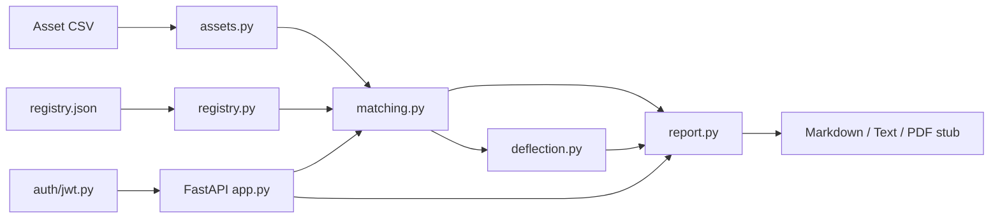

# rollover-auditor

**Deterministic audit of IT estates for forced vendor upgrade exposure.**
Single-tenant. No live scraping. Registry is curated manually (accuracy is the point).

## 90-second demo (concept)

A CIO gives you their asset CSV. `rollover-auditor` matches assets to a curated
registry of mega-vendor forced upgrade scenarios (Microsoft 365 E5→E7 tiering,
Salesforce Classic→Lightning, SAP ECC→S/4HANA, Oracle Java SE paid, VMware VCF
repositioning, IBM MQ metric change, ...) and emits a reproducible report with
risk scores and deterministic deflection recommendations. No LLM. No network.

```bash
uv sync
make test-strict
uv run uvicorn rollover.main:app --reload
curl -s http://127.0.0.1:8000/health
```

POST a CSV body to `/report` to get a markdown audit.

## Problem

Mega-vendors force upgrades through license metric changes, tiering, and end-of-life.
Finance learns about it at renewal. This tool surfaces exposure early and proposes
deterministic deflection plays.

## Architecture



## Build / test

```bash
uv sync
make test        # pytest
make lint        # ruff + mypy
make test-strict # all of the above
```

## Contract clause surfaced

> No representions or warranties. Registry is manually curated; verify scenarios
> against vendor contracts before acting. Single-tenant, offline only.

## License

MIT
